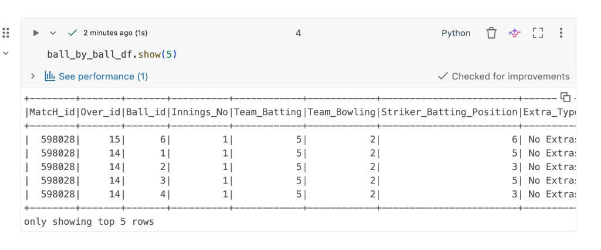

# Loading the tables

[Setup](s3-databricks-setup.md) makes the S3 bucket readable from Databricks. This step starts a Spark session, reads the five CSV files, and declares a schema so each column has a known type.

Spark can infer types from a sample of the file. An explicit schema is stricter: every incoming value is stored as the type you chose, and a value that does not fit becomes null instead of silently changing the column type.

## Start a session

```python
from pyspark.sql import SparkSession
from pyspark.sql.types import (
    StructType,
    StructField,
    IntegerType,
    StringType,
    BooleanType,
    DateType,
    DecimalType,
)

spark = SparkSession.builder.appName("IPL Data Analysis").getOrCreate()
```

On a Databricks cluster, `spark` already exists. Calling `getOrCreate()` reuses that session.

## Read the ball-by-ball file

A plain CSV read with a header treats every column as a string.

```python
ball_by_ball_df = (
    spark.read.format("csv")
    .option("header", "true")
    .load("s3://ipl-analyst-data-project/Ball_By_Ball.csv")
)
```

`option("inferSchema", "true")` samples the file and assigns string, integer, and date types automatically.

```python
ball_by_ball_df2 = (
    spark.read.format("csv")
    .option("header", "true")
    .option("inferSchema", "true")
    .load("s3://ipl-analyst-data-project/Ball_By_Ball.csv")
)

ball_by_ball_df.show(5)
```

The first five deliveries are match `598028`, innings 1, with teams stored as ids (`5` batting, `2` bowling) and `No Extras` on each ball.



The rest of the notebook builds on `ball_by_ball_df2`, the inferred frame. The schema below documents the intended types. It is not passed to `spark.read` yet, so it does not change `ball_by_ball_df2`.

```python
ball_by_ball_schema = StructType([
    StructField("match_id", IntegerType(), True),
    StructField("over_id", IntegerType(), True),
    StructField("ball_id", IntegerType(), True),
    StructField("innings_no", IntegerType(), True),
    StructField("team_batting", StringType(), True),
    StructField("team_bowling", StringType(), True),
    StructField("striker_batting_position", IntegerType(), True),
    StructField("extra_type", StringType(), True),
    StructField("runs_scored", IntegerType(), True),
    StructField("extra_runs", IntegerType(), True),
    StructField("wides", IntegerType(), True),
    StructField("legbyes", IntegerType(), True),
    StructField("byes", IntegerType(), True),
    StructField("noballs", IntegerType(), True),
    StructField("penalty", IntegerType(), True),
    StructField("bowler_extras", IntegerType(), True),
    StructField("out_type", StringType(), True),
    StructField("caught", BooleanType(), True),
    StructField("bowled", BooleanType(), True),
    StructField("run_out", BooleanType(), True),
    StructField("lbw", BooleanType(), True),
    StructField("retired_hurt", BooleanType(), True),
    StructField("stumped", BooleanType(), True),
    StructField("caught_and_bowled", BooleanType(), True),
    StructField("hit_wicket", BooleanType(), True),
    StructField("obstructingfeild", BooleanType(), True),
    StructField("bowler_wicket", BooleanType(), True),
    StructField("match_date", DateType(), True),
    StructField("season", IntegerType(), True),
    StructField("striker", IntegerType(), True),
    StructField("non_striker", IntegerType(), True),
    StructField("bowler", IntegerType(), True),
    StructField("player_out", IntegerType(), True),
    StructField("fielders", IntegerType(), True),
    StructField("striker_match_sk", IntegerType(), True),
    StructField("strikersk", IntegerType(), True),
    StructField("nonstriker_match_sk", IntegerType(), True),
    StructField("nonstriker_sk", IntegerType(), True),
    StructField("fielder_match_sk", IntegerType(), True),
    StructField("fielder_sk", IntegerType(), True),
    StructField("bowler_match_sk", IntegerType(), True),
    StructField("bowler_sk", IntegerType(), True),
    StructField("playerout_match_sk", IntegerType(), True),
    StructField("battingteam_sk", IntegerType(), True),
    StructField("bowlingteam_sk", IntegerType(), True),
    StructField("keeper_catch", BooleanType(), True),
    StructField("player_out_sk", IntegerType(), True),
    StructField("matchdatesk", DateType(), True),
])
```

To apply it on the next read:

```python
ball_by_ball_df2 = (
    spark.read.schema(ball_by_ball_schema)
    .format("csv")
    .option("header", "true")
    .load("s3://ipl-analyst-data-project/Ball_By_Ball.csv")
)
```

Field names have to match the CSV header exactly. The header uses `extra_runs`. The original notebook schema spelled that field `"extra runs"` (with a space), which would load the column as null. `obstructingfeild` is spelled that way in the schema on purpose, matching the source column.

## Match, player, player-match, and team

These four files are read with an explicit schema. `True` on each field means the column is nullable.

```python
match_schema = StructType([
    StructField("match_sk", IntegerType(), True),
    StructField("match_id", IntegerType(), True),
    StructField("team1", StringType(), True),
    StructField("team2", StringType(), True),
    StructField("match_date", DateType(), True),
    StructField("season_year", IntegerType(), True),
    StructField("venue_name", StringType(), True),
    StructField("city_name", StringType(), True),
    StructField("country_name", StringType(), True),
    StructField("toss_winner", StringType(), True),
    StructField("match_winner", StringType(), True),
    StructField("toss_name", StringType(), True),
    StructField("win_type", StringType(), True),
    StructField("outcome_type", StringType(), True),
    StructField("manofmach", StringType(), True),
    StructField("win_margin", IntegerType(), True),
    StructField("country_id", IntegerType(), True),
])

match_df = (
    spark.read.schema(match_schema)
    .format("csv")
    .option("header", "true")
    .load("s3://ipl-data-analysis-project/Match.csv")
)
```

```python
player_schema = StructType([
    StructField("player_sk", IntegerType(), True),
    StructField("player_id", IntegerType(), True),
    StructField("player_name", StringType(), True),
    StructField("dob", DateType(), True),
    StructField("batting_hand", StringType(), True),
    StructField("bowling_skill", StringType(), True),
    StructField("country_name", StringType(), True),
])

player_df = (
    spark.read.schema(player_schema)
    .format("csv")
    .option("header", "true")
    .load("s3://ipl-data-analysis-project/Player.csv")
)
```

```python
player_match_schema = StructType([
    StructField("player_match_sk", IntegerType(), True),
    StructField("playermatch_key", DecimalType(), True),
    StructField("match_id", IntegerType(), True),
    StructField("player_id", IntegerType(), True),
    StructField("player_name", StringType(), True),
    StructField("dob", DateType(), True),
    StructField("batting_hand", StringType(), True),
    StructField("bowling_skill", StringType(), True),
    StructField("country_name", StringType(), True),
    StructField("role_desc", StringType(), True),
    StructField("player_team", StringType(), True),
    StructField("opposit_team", StringType(), True),
    StructField("season_year", IntegerType(), True),
    StructField("is_manofthematch", BooleanType(), True),
    StructField("age_as_on_match", IntegerType(), True),
    StructField("isplayers_team_won", BooleanType(), True),
    StructField("batting_status", StringType(), True),
    StructField("bowling_status", StringType(), True),
    StructField("player_captain", StringType(), True),
    StructField("opposit_captain", StringType(), True),
    StructField("player_keeper", StringType(), True),
    StructField("opposit_keeper", StringType(), True),
])

player_match_df = (
    spark.read.schema(player_match_schema)
    .format("csv")
    .option("header", "true")
    .load("s3://ipl-data-analysis-project/Player_match.csv")
)
```

```python
team_schema = StructType([
    StructField("team_sk", IntegerType(), True),
    StructField("team_id", IntegerType(), True),
    StructField("team_name", StringType(), True),
])

team_df = (
    spark.read.schema(team_schema)
    .format("csv")
    .option("header", "true")
    .load("s3://ipl-data-analysis-project/Team.csv")
)
```

## Notes

- Import `StructType` with `StructField`. The schema constructors fail without it.
- Spark’s default CSV date format is `yyyy-MM-dd`. `dob` is null in the player preview, and `year`, `month`, and `day` extracted from `match_date` are null in the match preview. That pattern means the date strings in the files use a different format. Set `.option("dateFormat", "dd/MM/yyyy")` (or whichever pattern the file uses) on the reader, then reload.
- Column names in later cells mix `Match_id` and `match_id`. Spark resolves those as the same column while `spark.sql.caseSensitive` is `false`, which is the default.
- `team_batting` and `team_bowling` hold team ids in the preview (`5` and `2`), even though the hand-written schema types them as strings. Join them to `Team.csv` when you need a team name.

Next: [Transformations](transformations.md).
