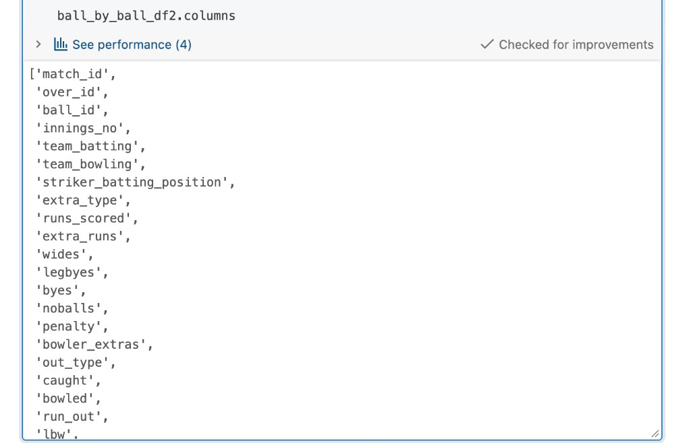
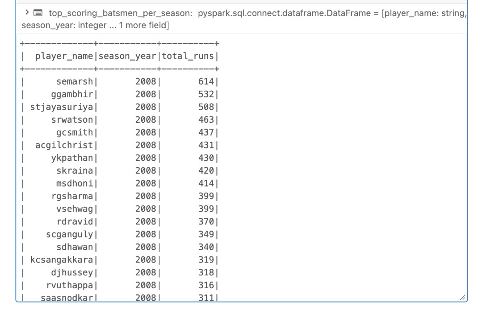
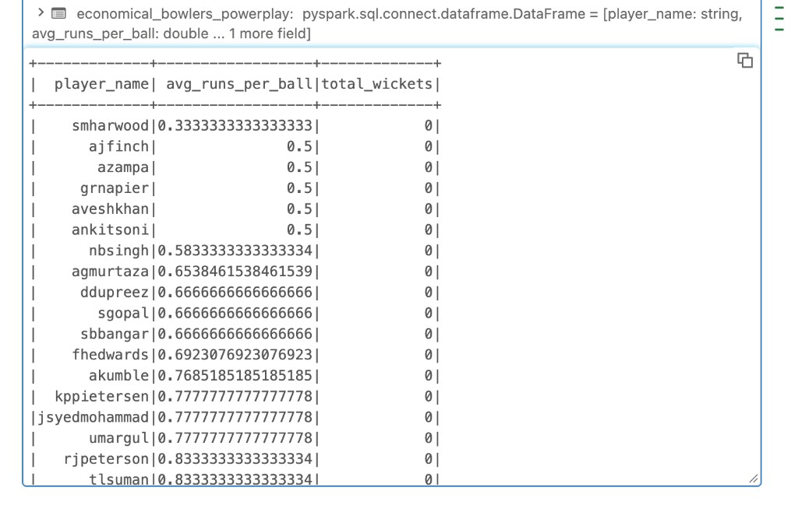
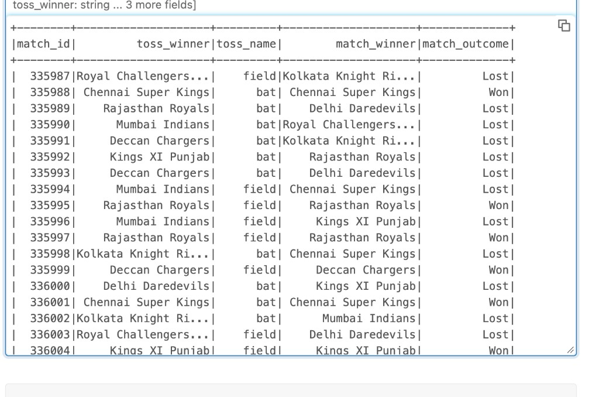
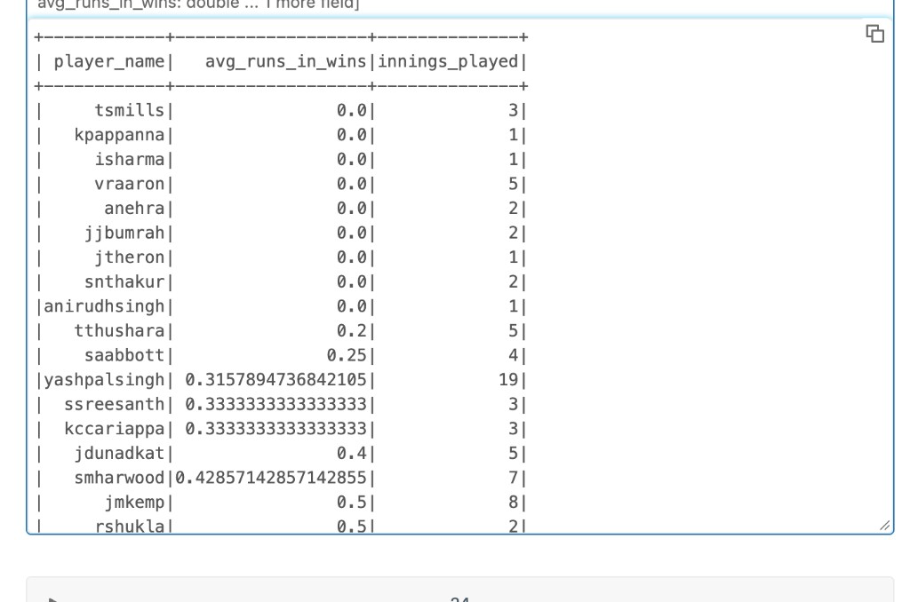

# SQL analysis

Spark SQL runs against temporary views. A view is a name for a DataFrame in this session. It disappears when the cluster session ends, and it does not create a table in Unity Catalog.

Register the frames from [Transformations](transformations.md) before any query. `player_match` has to be registered too. The batsman, bowler, and “runs in wins” queries all join it, and the original notebook created the other four views only.

```python
ball_by_ball_df2.createOrReplaceTempView("ball_by_ball")
match_df.createOrReplaceTempView("match")
player_df.createOrReplaceTempView("player")
player_match_df.createOrReplaceTempView("player_match")
team_df.createOrReplaceTempView("team")
```

`ball_by_ball_df2.columns` lists the delivery columns the queries group and filter on, including `runs_scored`, `over_id`, `out_type`, `striker`, and `bowler`.



Player names in these results are the cleaned form from the player transformation (`scganguly`, `semarsh`), because the queries join `player.player_name`.

## Top scoring batters by season

Runs are summed for the striker, grouped by player and season, then ordered so the highest total in each season comes first.

```python
top_scoring_batsmen_per_season = spark.sql("""
    SELECT
        p.player_name,
        m.season_year,
        SUM(b.runs_scored) AS total_runs
    FROM ball_by_ball b
    JOIN match m ON b.match_id = m.match_id
    JOIN player_match pm ON m.match_id = pm.match_id AND b.striker = pm.player_id
    JOIN player p ON p.player_id = pm.player_id
    GROUP BY p.player_name, m.season_year
    ORDER BY m.season_year, total_runs DESC
""")

top_scoring_batsmen_per_season.show(30)
```

The 2008 season is led by Shaun Marsh (`semarsh`) with 614 runs, then Gautam Gambhir (`ggambhir`) with 532 and Sanath Jayasuriya (`stjayasuriya`) with 508.



`show(30)` still only displays 2008 here because that season has more than 30 players once everyone with any runs is included. Filter `WHERE m.season_year = 2012` (or another year) to jump ahead, or add a rank:

```sql
RANK() OVER (PARTITION BY m.season_year ORDER BY SUM(b.runs_scored) DESC) AS season_rank
```

and keep `season_rank <= 10`.

## Economical bowlers in the powerplay

The powerplay in this query is overs 1 through 6 (`over_id <= 6`). `avg_runs_per_ball` is the mean of `runs_scored` on each delivery. Lower is more economical. The result is ordered by that average, then by wickets.

```python
economical_bowlers_powerplay = spark.sql("""
    SELECT
        p.player_name,
        AVG(b.runs_scored) AS avg_runs_per_ball,
        COUNT(b.bowler_wicket) AS total_wickets
    FROM ball_by_ball b
    JOIN player_match pm ON b.match_id = pm.match_id AND b.bowler = pm.player_id
    JOIN player p ON pm.player_id = p.player_id
    WHERE b.over_id <= 6
    GROUP BY p.player_name
    ORDER BY avg_runs_per_ball, total_wickets DESC
""")

economical_bowlers_powerplay.show()
```

Shane Harwood (`smharwood`) is first at about 0.33 runs per ball. Several bowlers sit at 0.50. Every visible `total_wickets` value is 0.



`COUNT(b.bowler_wicket)` counts non-null values. It counts a wicket only when the flag is null on balls that do not take a wicket. A `false` value is still counted. There is also no minimum number of balls, so a bowler with a handful of quiet deliveries ranks above someone who bowled the whole tournament. A tighter version requires a sample size and counts wickets explicitly:

```sql
AVG(b.runs_scored) AS avg_runs_per_ball,
SUM(CASE WHEN b.bowler_wicket = TRUE THEN 1 ELSE 0 END) AS total_wickets,
COUNT(*) AS balls_bowled
-- HAVING COUNT(*) >= 60
```

The [chart](visualizations.md#most-economical-powerplay-bowlers) uses the ten lowest averages from this frame.

## Toss winner and match result

Each match is labeled `Won` when the toss winner is also the match winner, and `Lost` otherwise. Rows with a null `toss_name` are dropped. `toss_name` is the decision, `bat` or `field`.

```python
toss_impact_individual_matches = spark.sql("""
    SELECT
        m.match_id,
        m.toss_winner,
        m.toss_name,
        m.match_winner,
        CASE
            WHEN m.toss_winner = m.match_winner THEN 'Won'
            ELSE 'Lost'
        END AS match_outcome
    FROM match m
    WHERE m.toss_name IS NOT NULL
    ORDER BY m.match_id
""")

toss_impact_individual_matches.show()
```

The original cell assigned this to `toss_impact_individual_matched` and then called `.toPandas()` on `toss_impact_individual_matches`. Those names have to be the same variable. The preview below is that result: early 2008 matches, with Chennai and Rajasthan among the sides that won after winning the toss.



The grouped bar chart of this table is in [Visualizations](visualizations.md#toss-winner-and-match-result).

## Runs per ball in wins

This keeps deliveries where the striker’s team is the match winner, then averages `runs_scored` per player. `innings_played` is a count of rows. Because the source is ball-by-ball, that count is deliveries faced in winning matches, not completed innings.

```python
average_runs_in_wins = spark.sql("""
    SELECT
        p.player_name,
        AVG(b.runs_scored) AS avg_runs_in_wins,
        COUNT(*) AS innings_played
    FROM ball_by_ball b
    JOIN player_match pm ON b.match_id = pm.match_id AND b.striker = pm.player_id
    JOIN player p ON pm.player_id = p.player_id
    JOIN match m ON pm.match_id = m.match_id
    WHERE m.match_winner = pm.player_team
    GROUP BY p.player_name
    ORDER BY avg_runs_in_wins ASC
""")

average_runs_in_wins.show()
```

The preview is the bottom of that sort: players whose average in wins is 0. A batter who faced one dot ball in a winning match appears here with `0.0` and `innings_played` of 1. The chart later takes the opposite end with `nlargest`.



Read `avg_runs_in_wins` as runs per ball. A 6.0 can be a single six. Divide `SUM(runs_scored)` by a count of innings (`COUNT(DISTINCT b.match_id)`) if the question is average innings score in wins.

## Scores by venue

The inner query totals `runs_scored` for each match at each venue. The outer query averages those match totals. Both innings of a match are added together, because the inner `GROUP BY` does not include `innings_no`.

```python
scores_by_venue = spark.sql("""
    SELECT venue_name, AVG(total_runs) AS average_score, MAX(total_runs) AS highest_score
    FROM (
        SELECT ball_by_ball.match_id, match.venue_name, SUM(runs_scored) AS total_runs
        FROM ball_by_ball
        JOIN match ON ball_by_ball.match_id = match.match_id
        GROUP BY ball_by_ball.match_id, match.venue_name
    )
    GROUP BY venue_name
    ORDER BY average_score DESC
""")
```

An average near 300 is plausible for both innings combined. It is a high number for a single IPL innings. Add `ball_by_ball.innings_no` to the inner `SELECT` and `GROUP BY` to score each innings on its own. The bar chart is in [Visualizations](visualizations.md#scores-by-venue).

## Dismissal types

```python
dismissal_types = spark.sql("""
    SELECT out_type, COUNT(*) AS frequency
    FROM ball_by_ball
    WHERE out_type IS NOT NULL
    GROUP BY out_type
    ORDER BY frequency DESC
""")
```

`Not Applicable` is a real string in this file, so it survives `IS NOT NULL` and dominates the count. The chart in [Visualizations](visualizations.md#dismissal-types) shows that bar stretching past 140,000 while `caught` is the first actual dismissal. Exclude the placeholder to compare how wickets fall:

```sql
WHERE out_type IS NOT NULL
  AND out_type NOT IN ('Not Applicable', 'N/A', '')
```

## Wins after winning the toss

`matches_played` counts matches in which `team1` won the toss. `wins_after_toss` counts how many of those the same team also won.

```python
team_toss_win_performance = spark.sql("""
    SELECT
        team1,
        COUNT(*) AS matches_played,
        SUM(CASE WHEN toss_winner = match_winner THEN 1 ELSE 0 END) AS wins_after_toss
    FROM match
    WHERE toss_winner = team1
    GROUP BY team1
    ORDER BY wins_after_toss DESC
""")
```

The filter `toss_winner = team1` drops every match where the toss winner is stored as `team2`. A team’s toss record in this result is only the matches where that team occupies the `team1` column. Union a matching query on `team2`, or replace `team1` with `toss_winner`:

```sql
SELECT
    toss_winner AS team,
    COUNT(*) AS matches_played,
    SUM(CASE WHEN toss_winner = match_winner THEN 1 ELSE 0 END) AS wins_after_toss
FROM match
WHERE toss_winner IS NOT NULL
GROUP BY toss_winner
ORDER BY wins_after_toss DESC
```

The ranking chart is in [Visualizations](visualizations.md#team-performance-after-winning-the-toss).

Next: [Visualizations](visualizations.md).
