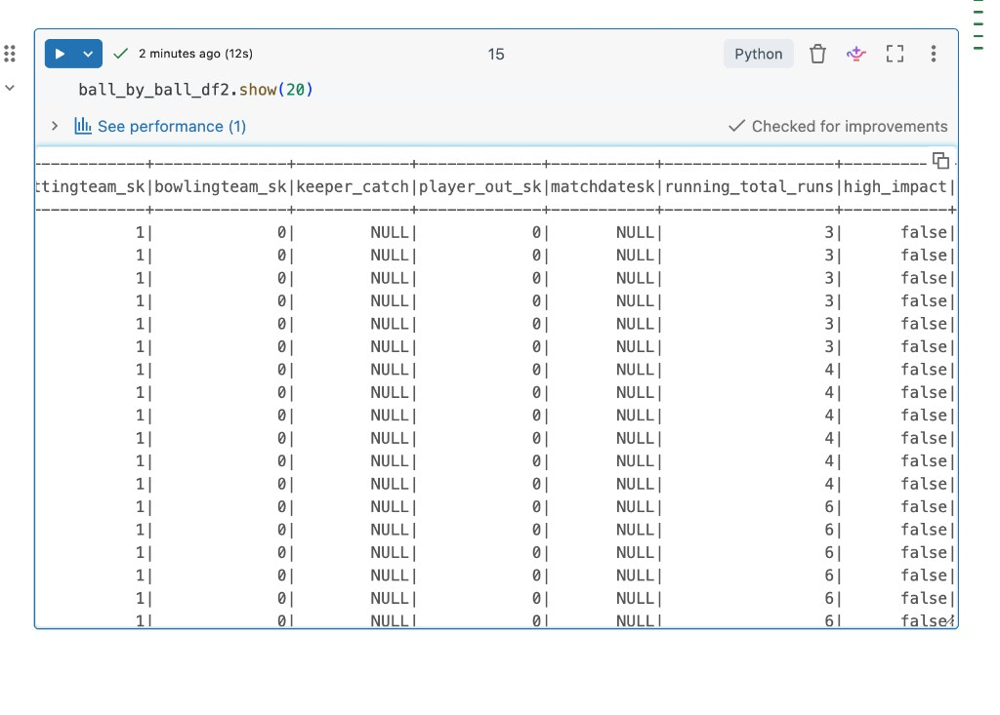
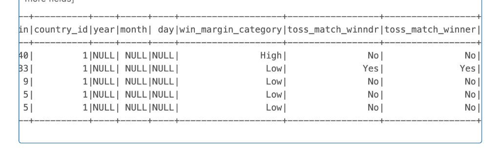
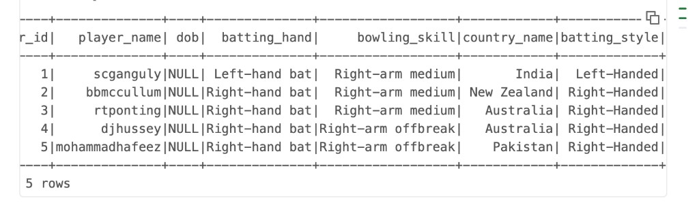
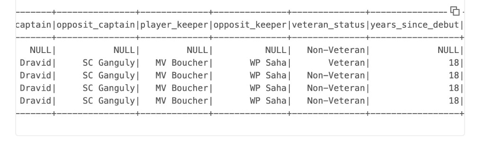

# Transformations

These steps add columns and filters on top of the frames from [Loading the tables](loading-data.md). Nothing is calculated while you only call `filter`, `groupBy`, `agg`, or `withColumn`. Spark records the plan and runs it when an action such as `show()` asks for a result. That is lazy evaluation: stack the transformations, then pay for the scan once.

Imports used below:

```python
from pyspark.sql.functions import (
    avg,
    col,
    current_date,
    dayofmonth,
    lower,
    month,
    regexp_replace,
    sum,
    when,
    year,
)
from pyspark.sql.window import Window
```

## Keep legal deliveries

Wides and no-balls are excluded so later averages count balls that were actually faced.

```python
ball_by_ball_df2 = ball_by_ball_df2.filter(
    (col("wides") == 0) & (col("noballs") == 0)
)
```

Both comparisons need their own parentheses. `&` binds less tightly than `==`, so this original expression does not mean "wides are 0 and no-balls are 0":

```python
(col("wides") == 0) & col("noballs") == 0
```

Python reads that as `((col("wides") == 0) & col("noballs")) == 0`.

## Runs per match and innings

`groupBy` and `agg` are transformations. Totals stay uncomputed until an action runs.

```python
total_and_avg_runs = ball_by_ball_df2.groupBy("match_id", "innings_no").agg(
    sum("runs_scored").alias("total_runs"),
    avg("runs_scored").alias("average_runs"),
)
```

## Running total through the overs

`partitionBy("match_id", "innings_no")` splits rows into one group per innings. `orderBy("over_id")` sorts each group from the first over to the last, so the sum moves forward through the innings.

```python
window_spec = Window.partitionBy("match_id", "innings_no").orderBy("over_id")

ball_by_ball_df2 = ball_by_ball_df2.withColumn(
    "running_total_runs",
    sum("runs_scored").over(window_spec),
)
```

The window is ordered only by `over_id`, not by `ball_id`. Every ball in the same over shares one running total: the sum of runs scored in that over and every earlier over. Add `.orderBy("over_id", "ball_id")` if the total should advance after each ball.

## High-impact balls

A ball is high impact when it produces more than 6 runs including extras, or when it takes a bowler wicket.

```python
ball_by_ball_df2 = ball_by_ball_df2.withColumn(
    "high_impact",
    when(
        (col("runs_scored") + col("extra_runs") > 6) | (col("bowler_wicket") == True),
        True,
    ).otherwise(False),
)
```

The preview shows the new columns at the right edge. Early in this innings the running total is 3, then 4, then 6, and `high_impact` is `false` because none of those balls cleared 6 runs or took a wicket.



## Match dates, win margin, and the toss

`year`, `month`, and `dayofmonth` split `match_date` for time-based analysis. The margin bands treat 100 or more as high, 50 to 99 as medium, and everything else as low. `toss_match_winner` is `Yes` when the toss winner also won the match.

```python
match_df = match_df.withColumn("year", year("match_date"))
match_df = match_df.withColumn("month", month("match_date"))
match_df = match_df.withColumn("day", dayofmonth("match_date"))

match_df = match_df.withColumn(
    "win_margin_category",
    when(col("win_margin") >= 100, "High")
    .when((col("win_margin") >= 50) & (col("win_margin") < 100), "Medium")
    .otherwise("Low"),
)

match_df = match_df.withColumn(
    "toss_match_winner",
    when(col("toss_winner") == col("match_winner"), "Yes").otherwise("No"),
)

match_df.show(5)
```



`year`, `month`, and `day` are null in that preview because `match_date` did not parse. See the date-format note in [Loading the tables](loading-data.md). `season_year` still loads from its own column, which is why the season rankings later in the project resolve to 2008.

`win_margin` mixes runs and wickets. A 100-run win and a 10-wicket win are different kinds of margin, and a 6-wicket win falls in the same `Low` band as a 6-run win. Split on `win_type` before comparing margins across matches.

## Clean player names and batting hand

`regexp_replace` strips every character that is not a letter or digit, then `lower` folds the name to lowercase. `SC Ganguly` becomes `scganguly`. Empty `batting_hand` and `bowling_skill` values are filled with `unknown`. A batting hand that contains `left` is labeled `Left-Handed`; every other value, including `unknown`, is labeled `Right-Handed`.

```python
player_df = player_df.withColumn(
    "player_name",
    lower(regexp_replace("player_name", "[^a-zA-Z0-9]", "")),
)

player_df = player_df.na.fill({"batting_hand": "unknown", "bowling_skill": "unknown"})

player_df = player_df.withColumn(
    "batting_style",
    when(lower(col("batting_hand")).contains("left"), "Left-Handed").otherwise("Right-Handed"),
)

player_df.show(5)
```



Filling nulls before the batting-style column means a missing batting hand is classified as right-handed. Check for `unknown` first if those players should stay unlabeled.

## Veteran status and years since the season

A player is a veteran in that match when `age_as_on_match` is at least 35. `years_since_debut` subtracts the match season from the current calendar year.

```python
player_match_df = player_match_df.withColumn(
    "veteran_status",
    when(col("age_as_on_match") >= 35, "Veteran").otherwise("Non-Veteran"),
)

player_match_df = player_match_df.withColumn(
    "years_since_debut",
    year(current_date()) - col("season_year"),
)

player_match_df.show(5)
```



The value `18` is the same on every row that has a season because those rows share `season_year`. For a 2008 season viewed in 2026, `2026 - 2008 = 18`. It is years since that match’s season, not years since each player’s debut. A null `season_year` produces a null result, which is the first row in the preview. A null `age_as_on_match` fails the `>= 35` test, so that row is labeled `Non-Veteran`.

Next: [SQL analysis](sql-analysis.md).
