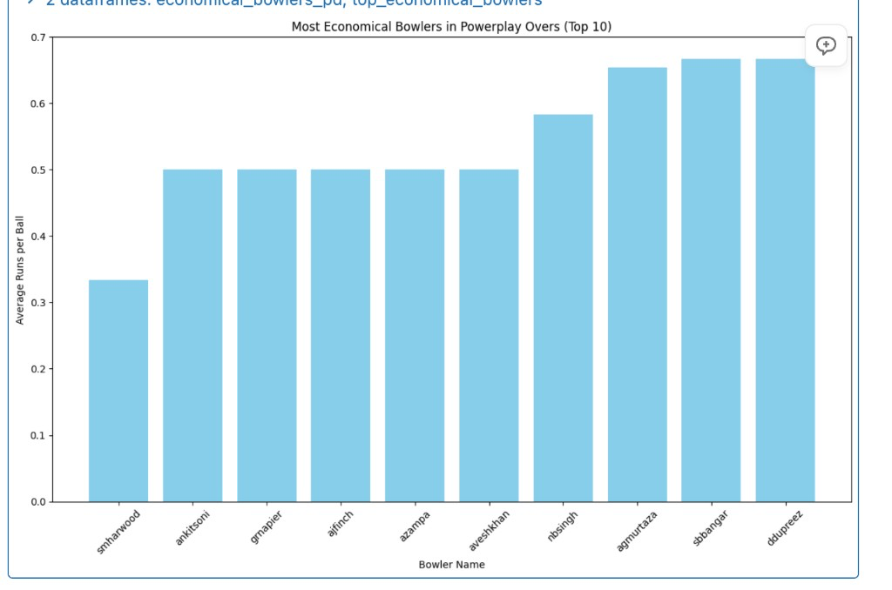
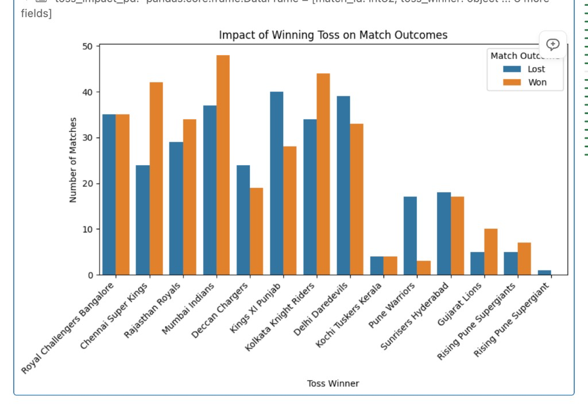
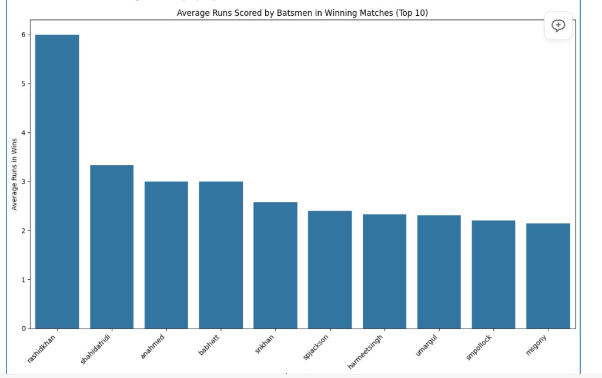
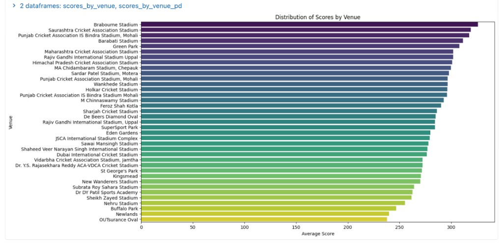
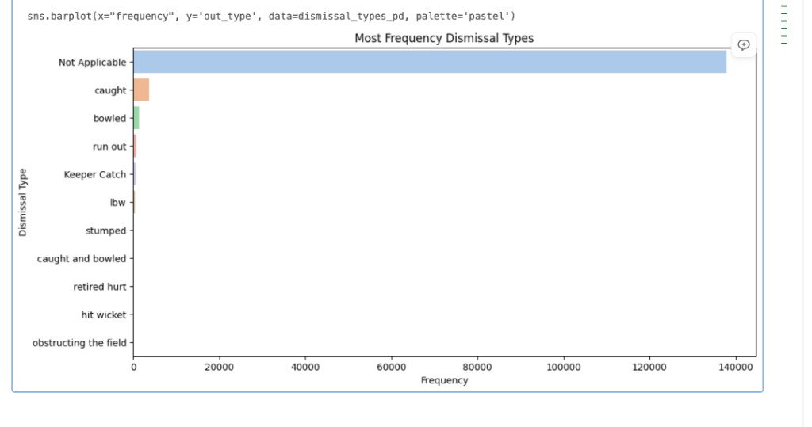
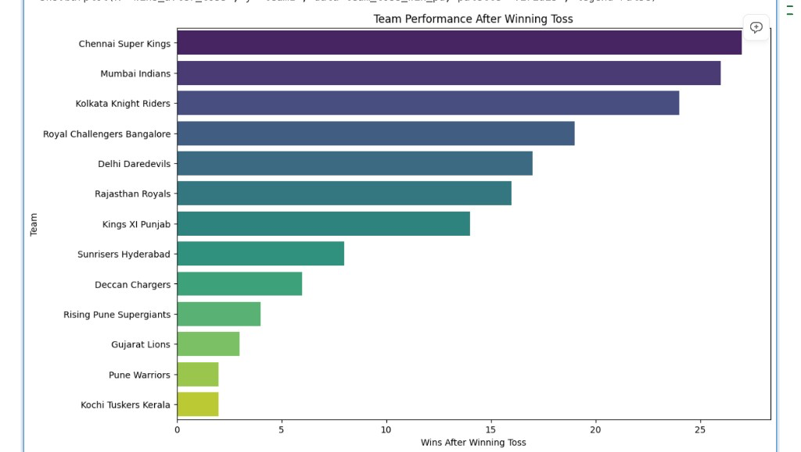

# Visualizations

Each chart starts from a Spark result in [SQL analysis](sql-analysis.md). `toPandas()` collects that result onto the driver as a pandas DataFrame. That is safe for these summaries because the grouped results are small. Collecting `ball_by_ball` itself would pull every delivery to the driver.

```python
import matplotlib.pyplot as plt
import seaborn as sns
```

Seaborn reads column names from the pandas frame. `x` and `y` are those column names. `hue` splits one categorical column into separate colored series. `palette` chooses the color scale. `legend=False` hides a legend when color is only a scale, not a second category.

## Most economical powerplay bowlers

`nsmallest(10, "avg_runs_per_ball")` keeps the ten lowest averages. The original notebook passed `top_ecomical_bowlers` (missing an `n`) to `plt.bar`. The name has to match the variable that `nsmallest` returns.

```python
economical_bowlers_pd = economical_bowlers_powerplay.toPandas()

top_economical_bowlers = economical_bowlers_pd.nsmallest(10, "avg_runs_per_ball")

plt.figure(figsize=(12, 8))
plt.bar(
    top_economical_bowlers["player_name"],
    top_economical_bowlers["avg_runs_per_ball"],
    color="skyblue",
)
plt.xlabel("Bowler Name")
plt.ylabel("Average Runs per Ball")
plt.title("Most Economical Bowlers in Powerplay Overs (Top 10)")
plt.xticks(rotation=45)
plt.tight_layout()
plt.show()
```



Shorter bars are the tighter spells. Shane Harwood is alone near 0.33. Ankit Soni, Graham Napier, Aaron Finch, Adam Zampa, and Avesh Khan share 0.50. The query has no minimum number of balls, so this ranking favors small samples as much as it favors control. See the wicket-count note in [SQL analysis](sql-analysis.md#economical-bowlers-in-the-powerplay).

## Toss winner and match result

`hue="match_outcome"` draws two bars for each toss winner: `Won` and `Lost`. `ha="right"` anchors the right edge of each rotated label on its tick, so the team names sit under the bars.

```python
toss_impact_pd = toss_impact_individual_matches.toPandas()

plt.figure(figsize=(9, 6))
sns.countplot(x="toss_winner", hue="match_outcome", data=toss_impact_pd)
plt.title("Impact of Winning Toss on Match Outcomes")
plt.xlabel("Toss Winner")
plt.ylabel("Number of Matches")
plt.legend(title="Match Outcome")
plt.xticks(rotation=45, ha="right")
plt.tight_layout()
plt.show()
```



Mumbai Indians and Chennai Super Kings win more of these matches than they lose. Deccan Chargers and Kings XI Punjab lose more of them. Royal Challengers Bangalore is close to even. Rising Pune Supergiant appears twice because the source data stores two spellings. Clean `toss_winner` with the same name normalization used on players, or map both spellings to one label, before comparing that franchise to the others.

A taller pair of bars means the team won the toss more often. Compare the orange bar with the blue bar inside one team. Comparing orange bars across teams mixes toss frequency with win rate.

## Average runs in winning matches

`nlargest(10, "avg_runs_in_wins")` takes the opposite end of the table shown in the SQL guide. The table preview is sorted ascending, so it shows the zeros. This chart shows the ten highest averages.

```python
average_runs_pd = average_runs_in_wins.toPandas()

top_scorers = average_runs_pd.nlargest(10, "avg_runs_in_wins")

plt.figure(figsize=(12, 8))
sns.barplot(x="player_name", y="avg_runs_in_wins", data=top_scorers)
plt.title("Average Runs Scored by Batsmen in Winning Matches (Top 10)")
plt.xlabel("Player Name")
plt.ylabel("Average Runs in Wins")
plt.xticks(rotation=45, ha="right")
plt.tight_layout()
plt.show()
```



Rashid Khan at 6.0 means every ball he faced in a winning match in this extract was a six. Shahid Afridi is next, a little above 3. The axis label “Average Runs in Wins” reads like an innings total. The SQL is `AVG(runs_scored)` on deliveries, so the axis is runs per ball, and a small number of boundaries outranks a top-order batter. Require a minimum `innings_played` (deliveries, given this query) before treating the order as a batting ranking.

## Scores by venue

`palette="viridis"` colors the bars from the highest average to the lowest. `legend=False` is set because the color repeats the bar length. There is no second category to explain.

```python
scores_by_venue_pd = scores_by_venue.toPandas()

plt.figure(figsize=(14, 8))
sns.barplot(
    x="average_score",
    y="venue_name",
    data=scores_by_venue_pd,
    palette="viridis",
    legend=False,
)
plt.title("Distribution of Scores by Venue")
plt.xlabel("Average Score")
plt.ylabel("Venue")
plt.show()
```



Brabourne Stadium leads, a little above 320. The lower end, including Newlands and OUTsurance Oval, sits in the mid-230s. Those figures are both innings of the match added together, then averaged across matches at that ground. Venues with very few matches can sit at either end. Join the inner query to a match count, and keep grounds with more than a handful of games, before calling a ground the highest-scoring venue in the league.

`sns.barplot` also draws an error bar when a category has more than one row. This frame is already one row per venue, so the bars are the averages from SQL with no extra interval.

## Dismissal types

```python
dismissal_types_pd = dismissal_types.toPandas()

plt.figure(figsize=(12, 6))
sns.barplot(
    x="frequency",
    y="out_type",
    data=dismissal_types_pd,
    palette="pastel",
)
plt.title("Most Frequency Dismissal Types")
plt.xlabel("Frequency")
plt.ylabel("Dismissal Type")
plt.show()
```



`Not Applicable` passes 140,000 because almost every ball is not a wicket. Caught is the next bar, then bowled, then run out. Keeper Catch, lbw, stumped, caught and bowled, retired hurt, hit wicket, and obstructing the field are thin enough to disappear on this scale. Filter those placeholders out in the SQL, then plot again, and the comparison between caught, bowled, and lbw becomes readable. Caught and Keeper Catch are separate labels in the source. Add them if “caught” should include catches by the wicketkeeper.

## Team performance after winning the toss

```python
team_toss_win_pd = team_toss_win_performance.toPandas()

plt.figure(figsize=(12, 8))
sns.barplot(
    x="wins_after_toss",
    y="team1",
    data=team_toss_win_pd,
    palette="viridis",
    legend=False,
)
plt.title("Team Performance After Winning Toss")
plt.xlabel("Wins After Winning Toss")
plt.ylabel("Team")
plt.show()
```



Chennai Super Kings have the most wins in this cut, just under 30, followed by Mumbai Indians and Kolkata Knight Riders. Kochi Tuskers Kerala, Pune Warriors, and Gujarat Lions sit at the bottom, which fits how briefly those teams played. The bar is a count of wins, not a win rate. A team that won the toss often will outrank a team that converted a higher share of fewer tosses. Plot `wins_after_toss / matches_played` once `matches_played` is in the frame.

This chart also inherits the `team1` filter from the SQL. Matches won after the toss by the side stored in `team2` are absent. The rewritten query in [SQL analysis](sql-analysis.md#wins-after-winning-the-toss) groups by `toss_winner` so each franchise is counted once.

Back to the [project overview](../README.md).
